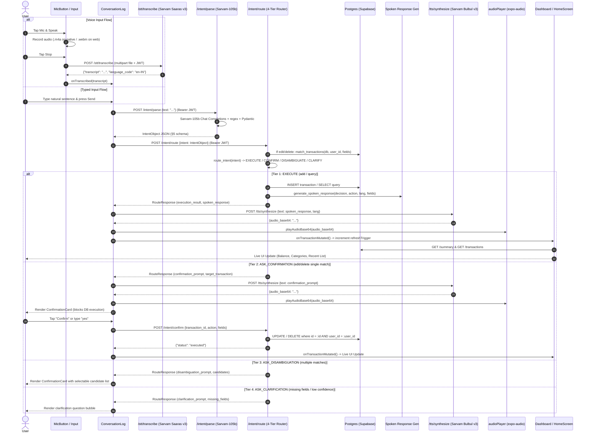

# Pappu — Actual Technical Implementation Breakdown

This document provides a comprehensive, code-accurate technical breakdown of the **Pappu** codebase as it is actually implemented across `backend/` and `frontend/`. It documents actual behavior, function signatures, data contracts, and architectural realities, explicitly flagging every divergence from [PROJECT_SPEC.md](file:///Users/sangeethps/pappu/PROJECT_SPEC.md), [CLAUDE.md](file:///Users/sangeethps/pappu/CLAUDE.md), and [BUILD_PHASES.md](file:///Users/sangeethps/pappu/BUILD_PHASES.md).

---

## 1. Architecture Overview

### 1.1 Real End-to-End Data Flow (Request Trace)

The implemented architecture supports two primary interaction modes in the frontend: **Voice Input** and **Typed Text Input**. Both converge into the same intent, routing, execution, response, and TTS pipeline.



#### Detailed Layer-by-Layer Request Execution:
1. **Frontend Input**:
   - Spoken audio is recorded in [`frontend/src/components/MicButton.js`](file:///Users/sangeethps/pappu/frontend/src/components/MicButton.js) using Expo Audio's hook `useAudioRecorder(RecordingPresets.HIGH_QUALITY)` on native iOS/Android (producing `.m4a`), or `MediaRecorder` on web (producing `.webm`).
   - The file is streamed via `XMLHttpRequest` directly using React Native's `RCTNetworking` bridge in [`frontend/src/api/client.js:161-193`](file:///Users/sangeethps/pappu/frontend/src/api/client.js#L161-L193) to circumvent Expo SDK 57's Winter fetch polyfill bug.
2. **STT Layer**:
   - Handled by `POST /stt/transcribe` in [`backend/app/routers/stt.py`](file:///Users/sangeethps/pappu/backend/app/routers/stt.py).
   - Validates the bearer token via `get_current_user_id` in [`backend/app/auth.py`](file:///Users/sangeethps/pappu/backend/app/auth.py).
   - Dispatches audio payload to Sarvam AI Saaras v3 (`saaras:v3`) via [`backend/app/stt/client.py`](file:///Users/sangeethps/pappu/backend/app/stt/client.py).
   - Returns transcript string, which calls `onTranscribed` in [`frontend/src/components/ConversationLog.js:385`](file:///Users/sangeethps/pappu/frontend/src/components/ConversationLog.js#L385).
3. **LLM Intent Layer**:
   - `handleSendMessage` calls `POST /intent/parse` in [`backend/app/routers/intent.py:107`](file:///Users/sangeethps/pappu/backend/app/routers/intent.py#L107).
   - Calls `SarvamLLMClient.parse_intent()` in [`backend/app/llm/client.py`](file:///Users/sangeethps/pappu/backend/app/llm/client.py), using `sarvam-105b` with `temperature: 0.1` and `reasoning_effort: null`.
   - Prompt loaded from [`backend/app/llm/intent_prompt.md`](file:///Users/sangeethps/pappu/backend/app/llm/intent_prompt.md) with dynamic date injection `Current date (IST): {today}`.
   - Output parsed and validated against `IntentObject` in [`backend/app/schemas/intent.py`](file:///Users/sangeethps/pappu/backend/app/schemas/intent.py).
4. **Confirmation & Routing Layer**:
   - `ConversationLog` posts the `IntentObject` to `POST /intent/route` in [`backend/app/routers/intent.py:140`](file:///Users/sangeethps/pappu/backend/app/routers/intent.py#L140).
   - If action is `edit` or `delete`, backend queries DB via `match_transactions()` in [`backend/app/services/matcher.py`](file:///Users/sangeethps/pappu/backend/app/services/matcher.py) to resolve `matched_transactions`.
   - Passes intent to pure routing function `route_intent()` in [`backend/app/services/routing.py`](file:///Users/sangeethps/pappu/backend/app/services/routing.py).
5. **Backend Execution & Database**:
   - If `EXECUTE`: `POST /intent/route` inserts the transaction (`action: add`) or performs query matching (`action: query`) directly.
   - If `ASK_CONFIRMATION`: No write occurs. Response includes transaction details. A separate `POST /intent/confirm` endpoint executes the change when confirmed.
6. **Response Generation & TTS**:
   - `generate_spoken_response()` in [`backend/app/llm/response_generator.py`](file:///Users/sangeethps/pappu/backend/app/llm/response_generator.py) formats a natural language string.
   - Frontend calls `POST /tts/synthesize` in [`backend/app/routers/tts.py`](file:///Users/sangeethps/pappu/backend/app/routers/tts.py), sending text to Sarvam AI Bulbul v3 (`bulbul:v3`) via [`backend/app/tts/client.py`](file:///Users/sangeethps/pappu/backend/app/tts/client.py).
   - Audio decoded and played via `playAudioBase64()` in [`frontend/src/utils/audioPlayer.js`](file:///Users/sangeethps/pappu/frontend/src/utils/audioPlayer.js).
7. **Live UI Update**:
   - `ConversationLog` calls `onTransactionMutated()`.
   - State lifted to [`frontend/src/screens/HomeScreen.js`](file:///Users/sangeethps/pappu/frontend/src/screens/HomeScreen.js), incrementing `refreshTrigger`.
   - Triggers `useEffect` re-fetch in [`frontend/src/components/Dashboard.js`](file:///Users/sangeethps/pappu/frontend/src/components/Dashboard.js) (`GET /summary` and `GET /transactions`), updating the live balance, category items, and recent passbook view.

---

### 1.2 Status of the 6 Layers from PROJECT_SPEC.md §3

| Layer | Spec Requirement (§3) | Actual Code Implementation Status | Drift / Gap Flag |
|---|---|---|---|
| **1. Frontend** | Mic input, dashboard, transaction history, charts, language toggle, conversation log. | **Built & Functional**. Built with React Native (Expo SDK 57) + NativeWind v4. Components: `Dashboard.js`, `ConversationLog.js`, `HistoryScreen.js`, `MicButton.js`, `AuthScreen.js`. | **Partial Drift**: Category charts use a dense list breakdown rather than SVG/Canvas charts (Recharts/Chart.js was omitted for native stability). Language toggle is stubbed (relies on utterance language auto-detection). |
| **2. STT Layer** | Speech → raw text (English/Malayalam/code-mixed) via Sarvam Saaras v3. | **Built & Functional**. Implemented in `backend/app/stt/client.py` and `backend/app/routers/stt.py` (`POST /stt/transcribe`). | None. Matches spec. |
| **3. LLM Intent Layer** | Raw text → structured intent object (§5). Does not touch the DB. Uses Sarvam-105b. | **Built & Functional**. Implemented in `backend/app/llm/client.py` and `backend/app/schemas/intent.py`. Tested with mocked and live tests. | None. Matches spec. |
| **4. Confirmation / Error-Recovery Layer** | Routes intent based on confidence/risk before backend writes (§6). Pure routing function. | **Built & Functional**. Implemented in `backend/app/services/routing.py` (`route_intent`) and `backend/app/routers/intent.py`. UI confirmation in `ConfirmationCard.js`. | None. Matches spec. |
| **5. Backend (FastAPI)** | CRUD/analytics operations, per-user isolation, JWT verification via JWKS. | **Built & Functional**. Implemented in `backend/app/routers/transactions.py`, `summary.py`, `intent.py`, `auth.py`. | None. Scoped strictly via `WHERE user_id = :verified_user_id`. |
| **6. Response Generation + TTS** | Backend result → natural language sentence (same language as input) → spoken audio via Sarvam Bulbul v3. | **Divergent Implementation**. TTS is fully built with Bulbul v3 (`backend/app/tts/client.py`), but Response Generation is **hardcoded Python string interpolation** in `backend/app/llm/response_generator.py`, **NOT an LLM call**. | **CRITICAL DRIFT**: Spec §3 & §6 state natural-language response generation should be an LLM step. `backend/app/llm/response_prompt.md` exists, but is dead code; `generate_spoken_response` uses hardcoded if/else rules. |

---

## 2. Database Layer

### 2.1 Actual Current Schema vs Spec §4

The database schema is defined in two places:
1. SQLAlchemy Python models: [`backend/app/models/`](file:///Users/sangeethps/pappu/backend/app/models/)
2. SQL Migration / provisioning script: [`backend/apply_schema.py`](file:///Users/sangeethps/pappu/backend/apply_schema.py) and `init_db()` in [`backend/app/database.py`](file:///Users/sangeethps/pappu/backend/app/database.py).

#### Profiles Table
- **Spec §4**:
  ```sql
  CREATE TABLE profiles (
      id UUID PRIMARY KEY REFERENCES auth.users(id) ON DELETE CASCADE,
      name TEXT NOT NULL,
      preferred_language TEXT NOT NULL DEFAULT 'en',
      created_at TIMESTAMPTZ DEFAULT now()
  );
  ```
- **Actual Model ([`backend/app/models/profile.py`](file:///Users/sangeethps/pappu/backend/app/models/profile.py))**:
  ```python
  class Profile(Base):
      __tablename__ = "profiles"
      id = Column(Uuid, primary_key=True, default=uuid.uuid4)
      name = Column(String, nullable=False)
      preferred_language = Column(String, nullable=False, default="en", server_default="en")
      created_at = Column(DateTime(timezone=True), server_default=func.now())
      transactions = relationship("Transaction", back_populates="profile", cascade="all, delete-orphan")
  ```
- **Schema Drift Note**: The SQLAlchemy model does **not** declare `ForeignKey("auth.users.id")`. This was intentionally omitted in Python to permit in-memory SQLite unit testing (where Supabase's `auth` schema does not exist). In PostgreSQL, the raw SQL executed by `apply_schema.py:20` enforces `REFERENCES auth.users(id) ON DELETE CASCADE`.

#### Categories Table
- **Actual Model ([`backend/app/models/category.py`](file:///Users/sangeethps/pappu/backend/app/models/category.py))**:
  ```python
  class Category(Base):
      __tablename__ = "categories"
      id = Column(Integer, primary_key=True, autoincrement=True)
      name = Column(String, unique=True, nullable=False, index=True)
      type = Column(String, nullable=False)  # 'income' | 'expense'
      transactions = relationship("Transaction", back_populates="category")
  ```
- **Seed Data ([`backend/app/services/category_seed.py`](file:///Users/sangeethps/pappu/backend/app/services/category_seed.py))**:
  Exactly 7 categories:
  - `Food` (expense)
  - `Transport` (expense)
  - `Shopping` (expense)
  - `Bills` (expense)
  - `Entertainment` (expense)
  - `Salary` (income)
  - `Other` (expense)
  *Matches Spec §4 and §7 exactly.*

#### Transactions Table
- **Actual Model ([`backend/app/models/transaction.py`](file:///Users/sangeethps/pappu/backend/app/models/transaction.py))**:
  ```python
  class Transaction(Base):
      __tablename__ = "transactions"
      id = Column(Uuid, primary_key=True, default=uuid.uuid4)
      user_id = Column(Uuid, ForeignKey("profiles.id", ondelete="CASCADE"), nullable=False, index=True)
      type = Column(String, nullable=False)  # 'income' | 'expense'
      amount = Column(Numeric(12, 2), nullable=False)
      category_id = Column(Integer, ForeignKey("categories.id"), nullable=False, index=True)
      description = Column(Text, nullable=True)
      txn_date = Column(Date, nullable=False, index=True)
      created_at = Column(DateTime(timezone=True), server_default=func.now())
      profile = relationship("Profile", back_populates="transactions")
      category = relationship("Category", back_populates="transactions")
  ```
  *Matches Spec §4 fields and types.*

---

### 2.2 JWT Verification Implementation

- **File**: [`backend/app/auth.py`](file:///Users/sangeethps/pappu/backend/app/auth.py)
- **Function**: `get_current_user_id(authorization: str | None = Header(None)) -> uuid.UUID`
- **JWKS / ES256 Confirmation**:
  - The implementation uses `PyJWT`'s `PyJWKClient` initialized at module load:
    ```python
    ssl_context = ssl.create_default_context(cafile=certifi.where())
    jwks_client = PyJWKClient(SUPABASE_JWKS_URL, cache_keys=True, ssl_context=ssl_context)
    ```
  - Incoming tokens are decoded strictly with:
    ```python
    signing_key = jwks_client.get_signing_key_from_jwt(token)
    payload = jwt.decode(
        token,
        signing_key.key,
        algorithms=["ES256"],
        options={"verify_aud": False},
    )
    user_id_str = payload.get("sub")
    return uuid.UUID(user_id_str)
    ```
  - **Verdict**: **CONFIRMED**. It strictly uses JWKS and asymmetric **ES256**, caching the public keys. It does **not** use symmetric HS256 or any `SUPABASE_JWT_SECRET`.
  - Rejection behavior: Raises HTTP 401 on missing header, malformed header, expired token, invalid signature, or missing/invalid `sub` claim.

---

### 2.3 Exact Mechanism of Per-User Isolation

Per `PROJECT_SPEC.md §4` and `CLAUDE.md Rule 7`, the backend connects to Postgres via the `postgres` role (which bypasses PostgreSQL RLS). Therefore, **application-layer filtering** is the primary isolation boundary.

| Endpoint | File | Line | Application-Layer Enforcement | Missing Check? |
|---|---|---|---|---|
| `POST /transactions` | `routers/transactions.py` | 60 | `user_id=current_user_id` assigned directly from token | No |
| `GET /transactions` | `routers/transactions.py` | 92 | `.filter(Transaction.user_id == current_user_id)` | No |
| `PUT /transactions/{id}` | `routers/transactions.py` | 127 | `.filter(Transaction.id == id, Transaction.user_id == current_user_id)` | No |
| `DELETE /transactions/{id}` | `routers/transactions.py` | 173 | `.filter(Transaction.id == id, Transaction.user_id == current_user_id)` | No |
| `POST /transactions/undo` | `services/undo.py` | 23 | `.filter(Transaction.user_id == user_id)` | No |
| `GET /summary` | `routers/summary.py` | 19 | `.filter(Transaction.user_id == current_user_id)` | No |
| `POST /intent/route` (matching) | `services/matcher.py` | 31 | `.filter(Transaction.user_id == user_id)` | No |
| `POST /intent/route` (add) | `routers/intent.py` | 201 | `user_id=current_user_id` assigned directly | No |
| `POST /intent/route` (confirm details) | `routers/intent.py` | 232 | `.filter(Transaction.id == target_uuid, Transaction.user_id == current_user_id)` | No |
| `POST /intent/route` (disambig candidates) | `routers/intent.py` | 247 | `.filter(Transaction.id == txn_uuid, Transaction.user_id == current_user_id)` | No |
| `POST /intent/confirm` | `routers/intent.py` | 280 | `.filter(Transaction.id == payload.transaction_id, Transaction.user_id == current_user_id)` | No |

**Audit Result**: **Zero endpoints miss isolation**. Every query touching transactions filters by `current_user_id`. `user_id` passed in request bodies is never trusted or accepted.

---

## 3. LLM Intent Layer

### 3.1 Prompt Templates and File Paths
- **Versioned Prompt File**: [`backend/app/llm/intent_prompt.md`](file:///Users/sangeethps/pappu/backend/app/llm/intent_prompt.md) (Header: `Pappu Intent Parsing Prompt — v1.2`).
- **Loader & Injection**: In [`backend/app/llm/client.py:35-45`](file:///Users/sangeethps/pappu/backend/app/llm/client.py#L35-L45):
  ```python
  def _inject_today_date(prompt: str) -> str:
      today = date.today().isoformat()
      date_context = f"\n\nCurrent date (IST): {today}\n"
      return prompt + date_context
  ```
- **Prompt Structure**:
  - Requires output strictly in JSON without markdown fences.
  - Defines action rules (`add`, `edit`, `delete`, `query`), specifically instructing that Malayalam reduction verbs (*"kurakku"*, *"കുറയ്ക്കുക"*, *"subtract"*, *"reduce"*) are `edit`, not `add`.
  - Defines language detection (`en`, `ml`, `mixed`).
  - Constrains categories strictly to the 7 seeded categories.
  - Mandates unquoted numbers for `fields.amount`.
  - Defines balanced few-shot examples across English, Malayalam script, and Manglish.

---

### 3.2 Schema Validation Implementation & Recovery
- **Pydantic Models**: Defined in [`backend/app/schemas/intent.py`](file:///Users/sangeethps/pappu/backend/app/schemas/intent.py).
  - `IntentFields`:
    ```python
    amount: Optional[Union[float, int]] = None
    category: Optional[str] = None
    date: Optional[str] = None
    description: Optional[str] = None
    ```
  - Coercion logic in `coerce_amount` strips commas and whitespace (e.g. `"1,500"` → `1500`).
  - Safety net in `handle_non_numeric_or_missing_amount`: If the LLM generates a non-numeric string (e.g. `"many"` or `"unknown"`), the validator intercepts it, clears `fields.amount = None`, adds `"amount"` to `missing_fields`, and downgrades `confidence = "low"`.
- **Validation Rules Enforced (§5)**:
  - `action == "add"` must have `requires_confirmation == False`.
  - `action in ("edit", "delete")` with 1 match must have `requires_confirmation == True`.
  - `action in ("edit", "delete")` with >1 matches must **not** set `requires_confirmation == True` (must route to disambiguation).
- **Malformed LLM Output Handling**:
  - `parse_intent(user_text, max_retries=1)` in `backend/app/llm/client.py`:
    1. Runs regex `_extract_json_from_response` to strip markdown code blocks.
    2. If JSON parsing or Pydantic validation fails, it appends the invalid output to the chat history and issues a correction turn:
       `"Your previous output was invalid: {e}. Please output ONLY a single valid JSON object matching the schema. No explanation, no markdown."`
    3. Retries once. If the second attempt fails, raises `IntentValidationError`.
    4. Router returns HTTP 422 Unprocessable Entity.

---

### 3.3 Known Failure Modes and Breaking Input Cases

1. **Amount Filter Blindness in Transaction Matcher**:
   - **Trigger**: "Delete the 500 rupees transaction" or "Edit the 1000 rupees expense".
   - **Root Cause**: In [`backend/app/services/matcher.py:28-58`](file:///Users/sangeethps/pappu/backend/app/services/matcher.py#L28-L58), `match_transactions` queries by `category`, `date`, and `description`, but **completely omits filtering on `fields.amount`**.
   - **Impact**: If a user has multiple transactions under that category or date, Pappu cannot isolate the target by amount and always forces disambiguation or clarification.
2. **`matched_transactions` Contract Contradiction**:
   - **Trigger**: Initial intent parsing for edit/delete.
   - **Root Cause**: `PROJECT_SPEC.md §5` requires the intent object to contain `matched_transactions: ["txn_id_1"]`. However, `CLAUDE.md Rule 1` dictates that the LLM cannot query the database.
   - **Code Reality**: `intent_prompt.md:78` commands the LLM to output `matched_transactions: []`. Thus, initial LLM output for an edit/delete will **never** have matched transactions until the backend intercepts it in `POST /intent/route` and populates them.
3. **Manglish Misclassified as English**:
   - **Trigger**: Spoken/typed Manglish with heavy English borrowing (e.g. *"Yesterday 2k shopping cheythu"*).
   - **Observed Behavior**: In live test [`backend/tests/test_intent_live.py:120`](file:///Users/sangeethps/pappu/backend/tests/test_intent_live.py#L120), the test had to allow both:
     ```python
     assert intent.language in ("mixed", "en")  # LLM may detect as either
     ```
     Sarvam-105b regularly flags Latin-script Manglish as `en`.
4. **Relative Dates Beyond Today/Yesterday**:
   - **Trigger**: Inputs like "last Friday", "day before yesterday", "3 days ago".
   - **Impact**: The prompt only provides instructions for "today", "yesterday", and "this/last month". Complex relative offsets are often hallucinated or output as `null`.

---

## 4. Confirmation & Routing Layer

### 4.1 Actual Routing Logic (Code Implementation)

- **File**: [`backend/app/services/routing.py`](file:///Users/sangeethps/pappu/backend/app/services/routing.py)
- **Function**: `route_intent(intent: IntentObject) -> RoutingResult`

```python
def route_intent(intent: IntentObject) -> RoutingResult:
    # Tier 4: Low confidence or missing required fields
    if intent.confidence == "low" or len(intent.missing_fields) > 0:
        missing_str = ", ".join(intent.missing_fields) if intent.missing_fields else "required information"
        clarification_msg = f"Please specify {missing_str}."
        if intent.language == "ml":
            clarification_msg = f"ദയവായി {missing_str} വ്യക്തമാക്കുക."

        return RoutingResult(
            decision=RoutingDecision.ASK_CLARIFICATION,
            action=intent.action,
            confidence=intent.confidence,
            matched_transactions=intent.matched_transactions,
            missing_fields=intent.missing_fields,
            clarification_prompt=clarification_msg,
        )

    # Edit and Delete routing
    if intent.action in ("edit", "delete"):
        num_matches = len(intent.matched_transactions)

        # Tier 3: Multiple matches -> Disambiguation
        if num_matches > 1:
            disambig_msg = f"Multiple transactions match your request ({num_matches} found). Please select which one to {intent.action}."
            if intent.language == "ml":
                disambig_msg = f"{num_matches} ഇടപാടുകൾ കണ്ടെത്തി. ഏതാണ് {intent.action} ചെയ്യേണ്ടതെന്ന് തിരഞ്ഞെടുക്കുക."

            return RoutingResult(
                decision=RoutingDecision.ASK_DISAMBIGUATION,
                action=intent.action,
                confidence=intent.confidence,
                matched_transactions=intent.matched_transactions,
                missing_fields=intent.missing_fields,
                disambiguation_prompt=disambig_msg,
            )

        # Tier 2: Single match -> Confirmation
        if num_matches == 1:
            target_id = intent.matched_transactions[0]
            confirm_msg = f"Are you sure you want to {intent.action} transaction {target_id}?"
            if intent.language == "ml":
                confirm_msg = f"{target_id} എന്ന ഇടപാട് {intent.action} ചെയ്യാൻ തീർച്ചയാണോ?"

            return RoutingResult(
                decision=RoutingDecision.ASK_CONFIRMATION,
                action=intent.action,
                confidence=intent.confidence,
                matched_transactions=intent.matched_transactions,
                missing_fields=intent.missing_fields,
                confirmation_prompt=confirm_msg,
            )

        # 0 matches found for edit/delete -> Cannot execute, ask clarification
        return RoutingResult(
            decision=RoutingDecision.ASK_CLARIFICATION,
            action=intent.action,
            confidence=intent.confidence,
            matched_transactions=[],
            missing_fields=["transaction_match"],
            clarification_prompt="No matching transaction found. Please provide more details.",
        )

    # Tier 1: Add or Query with high confidence -> Execute immediately
    return RoutingResult(
        decision=RoutingDecision.EXECUTE,
        action=intent.action,
        confidence=intent.confidence,
        matched_transactions=intent.matched_transactions,
        missing_fields=intent.missing_fields,
    )
```

---

### 4.2 Edge Cases Not Handled Correctly

1. **Undo Destructive Behavior on Prior Edits**:
   - `undo_last_transaction` in [`backend/app/services/undo.py`](file:///Users/sangeethps/pappu/backend/app/services/undo.py) executes:
     ```python
     last_txn = db.query(Transaction).filter(Transaction.user_id == user_id).order_by(Transaction.created_at.desc(), Transaction.txn_date.desc()).first()
     db.delete(last_txn)
     ```
   - If User A creates a transaction, then **edits** an older transaction, calling "undo" does **not** revert the edit. It permanently deletes whatever transaction had the highest `created_at` timestamp.
2. **Hardcoded Confirmation Keywords in Frontend**:
   - In [`frontend/src/components/ConversationLog.js:67`](file:///Users/sangeethps/pappu/frontend/src/components/ConversationLog.js#L67):
     ```javascript
     if (pendingConfirmation && ['yes', 'confirm', 'sure', 'ok', 'aam'].includes(text.toLowerCase()))
     ```
   - If a user responds in Malayalam script (e.g. *"ശരി"*, *"അതെ"*, *"തീർച്ചയായും"*), it will fail the match and attempt to parse the word as a new transaction intent.
3. **Hard Limit of 10 on Disambiguation**:
   - `match_transactions` has `limit: int = 10`. If the user has 15 matching transactions, only 10 are returned for disambiguation with no pagination.

---

## 5. Backend API

### 5.1 Endpoint Inventory vs Spec §8

| Method | Endpoint | Spec §8 Status | Implementation Location | Request Payload | Response Shape |
|---|---|---|---|---|---|
| `GET` | `/health` | Unspecified | `main.py:24` | None | `{"status": "ok", "database": "connected"}` |
| `POST` | `/intent/parse` | Unspecified (Phase 3) | `routers/intent.py:107` | `{"text": str}` | `{"intent": IntentObject}` |
| `POST` | `/intent/route` | **In Spec §8** | `routers/intent.py:140` | `{"intent": IntentObject}` | `IntentRouteResponse` (decision, prompts, results) |
| `POST` | `/intent/confirm` | Unspecified (Phase 4) | `routers/intent.py:270` | `{"transaction_id": UUID, "action": "edit"\|"delete", "fields": Optional[IntentFields]}` | `{"status": "executed", "action": str, "transaction": dict}` |
| `POST` | `/transactions` | **In Spec §8** | `routers/transactions.py:44` | `TransactionCreate` (type, amount, category_id, txn_date, description) | `TransactionResponse` (status 201) |
| `GET` | `/transactions` | **In Spec §8** | `routers/transactions.py:83` | Query params (`category_id`, `type`, `start_date`, `end_date`) | `List[TransactionResponse]` |
| `PUT` | `/transactions/{id}` | **In Spec §8** | `routers/transactions.py:120` | `TransactionUpdate` (partial fields) | `TransactionResponse` |
| `DELETE` | `/transactions/{id}` | **In Spec §8** | `routers/transactions.py:167` | Path param `{id}` | `{"status": "deleted", "id": str}` |
| `POST` | `/transactions/undo`| Unspecified (Phase 4) | `routers/transactions.py:27` | None | `{"status": "undone", "transaction": dict}` |
| `GET` | `/summary` | **In Spec §8** | `routers/summary.py:14` | None | `SummaryResponse` (balance, total_income, total_expense, category_breakdown) |
| `POST` | `/stt/transcribe` | Unspecified (Phase 6) | `routers/stt.py:11` | Multipart Form (`file`: UploadFile, `language_code`: Optional[str]) | `STTResponse` (transcript, language_code, request_id) |
| `POST` | `/tts/synthesize` | Unspecified (Phase 7) | `routers/tts.py:17` | `{"text": str, "target_language_code": str, "speaker": str, "pace": float}` | `TTSResponse` (audio_base64, audio_format, language_code) |

---

### 5.2 Auth Middleware Details

All endpoints (except `GET /health`) inject:
```python
current_user_id: uuid.UUID = Depends(get_current_user_id)
```
- Expects `Authorization: Bearer <token>`.
- Calls `jwks_client.get_signing_key_from_jwt(token)`.
- Validates cryptographic signature using Supabase's ES256 public key.
- Extracts `sub` claim and parses into Python `uuid.UUID`.
- Rejects any token with HTTP 401 if missing, expired, invalid signature, or invalid UUID.

---

## 6. Frontend

### 6.1 Component Structure
```
frontend/src/
├── api/
│   ├── client.js           # API methods wrapping fetch and XMLHttpRequest
│   └── supabase.js         # Supabase client SDK (Auth: signUp, signIn, signOut, getSession)
├── components/
│   ├── ConversationLog.js  # Chat stream, input bar, mic integration, confirmation cards
│   ├── Dashboard.js        # Balance hero, category breakdown list, recent transactions
│   ├── HistoryScreen.js    # Full passbook transaction history grouped by date
│   ├── MicButton.js        # Audio recording button (expo-audio on native / MediaRecorder on web)
│   └── ui/
│       ├── Balance.js          # Hero balance display card
│       ├── ConfirmationCard.js # Inline confirmation/disambiguation card
│       ├── MessageBubble.js    # User/assistant chat bubbles with TTS replay button
│       └── TransactionRow.js   # Passbook transaction item
├── screens/
│   ├── AuthScreen.js       # Email/Password Sign-In and Sign-Up form
│   └── HomeScreen.js       # Root coordinator with bottom tabs (Dashboard, Assistant, History)
└── utils/
    └── audioPlayer.js      # Cross-platform base64 audio player (expo-audio / window.Audio)
```

### 6.2 State Management & Synchronization Approach
- **No external state libraries**: The project uses pure React component state (`useState`, `useRef`, `useEffect`).
- **Reactive Dashboard Updates**:
  - `HomeScreen` maintains an integer state: `const [refreshTrigger, setRefreshTrigger] = useState(0);`.
  - `HomeScreen` passes `handleTransactionMutated = () => setRefreshTrigger(prev => prev + 1)` into `ConversationLog`.
  - Whenever an action executes in `ConversationLog` (`decision === 'EXECUTE'` or `handleConfirmAction`), it calls `onTransactionMutated()`.
  - `Dashboard` and `HistoryScreen` include `refreshTrigger` in their `useEffect([token, refreshTrigger])` dependency array, immediately triggering a background fetch of `/summary` and `/transactions` without page reloads.

---

## 7. Known Bugs, Incomplete Areas & Rule Violations

### 7.1 Incomplete Phases
- **Phase 8 (Full Voice End-to-End Test Script)**: Not automated as a single non-mocked continuous script. Integration is validated through mocked tests and live individual component tests.
- **Phase 9 (AI-Driven Intelligence)**: **Completely Missing**. No spending pattern analysis, month-over-month comparison, budget alerts, or savings estimations are implemented in backend or frontend.

### 7.2 Known Bugs & Workarounds in Code
1. **Pytest Collection Failure on Bare `pytest`**:
   [`backend/test_live_api.py`](file:///Users/sangeethps/pappu/backend/test_live_api.py) is named with a `test_` prefix and placed in `backend/` root. Running `pytest` without path filters attempts to run it as a test file, immediately crashing because it tries to connect to `http://127.0.0.1:8000`. Running tests requires `PYTHONPATH=. pytest tests/`.
2. **Hardcoded Local Development IP in Frontend**:
   [`frontend/src/api/client.js:6`](file:///Users/sangeethps/pappu/frontend/src/api/client.js#L6) has a hardcoded default IP:
   ```javascript
   const API_BASE_URL = process.env.EXPO_PUBLIC_API_URL || 'http://192.168.29.82:8000';
   ```
   If environment variables are missing on a different network, requests fail.
3. **Matcher Ignores Amount**:
   [`backend/app/services/matcher.py`](file:///Users/sangeethps/pappu/backend/app/services/matcher.py) never filters on `fields.amount`, breaking disambiguation when amount is the distinguishing attribute.
4. **Edit Undo is Destructive**:
   [`backend/app/services/undo.py`](file:///Users/sangeethps/pappu/backend/app/services/undo.py) deletes the newest transaction rather than rolling back edited fields.
5. **Defensive DB Profile Insertion**:
   `_ensure_profile_exists` is called in both `transactions.py` and `intent.py` because the Supabase `handle_new_user` Postgres trigger is bypassed in test fixtures or mock auth scenarios.

### 7.3 CLAUDE.md & Spec Violations
1. **CLAUDE.md Non-Negotiable Rule 1 & Spec §3 Layer 6 (Response Generation)**:
   - *Spec §3*: "backend result → natural-language sentence (same language as input)".
   - *Violation*: `generate_spoken_response` in [`backend/app/llm/response_generator.py`](file:///Users/sangeethps/pappu/backend/app/llm/response_generator.py) is a hardcoded Python `if/else` function with static string templates. It never queries an LLM, making `backend/app/llm/response_prompt.md` dead code.
2. **PROJECT_SPEC.md §2 (NativeWind/Charts)**:
   - *Spec §2*: "Recharts/Chart.js-equivalent for charts".
   - *Actual*: Graphical charts were omitted entirely in favor of plain text/list category breakdowns in `Dashboard.js`.

---

## 8. Testing Audit

### 8.1 Existing Test Coverage

```
backend/tests/ (14 test files, 141 passing tests)
├── test_auth.py                        # 7 tests: ES256 key decoding, missing headers, expired/invalid tokens
├── test_confirmation_integration.py     # 7 tests: Add execution, delete confirmation, disambiguation, undo, isolation
├── test_health.py                      # 1 test: Health endpoint & DB connection check
├── test_intent_live.py                 # 17 tests: Live Sarvam-105b intent parsing (skipped if no API key)
├── test_intent_parsing.py              # 39 tests: Mocked LLM responses across all 4 actions & languages
├── test_intent_schema.py               # 22 tests: Schema rules, validation errors, amount coercion
├── test_isolation.py                   # 1 test: Multi-user application-layer data isolation
├── test_models.py                      # 4 tests: SQLAlchemy model relationships and default constraints
├── test_routing.py                     # 10 tests: Unit tests for all 4 routing tiers (route_intent)
├── test_schema.py                      # 5 tests: Migration, table existence, and fixed category seed
├── test_stt.py                         # 7 tests: Saaras v3 client, mime handling, /stt/transcribe endpoint
├── test_summary.py                     # 2 tests: /summary calculation of income, expense, balance
├── test_transactions.py                # 6 tests: CRUD operations, filtering, 401 unauthenticated
└── test_tts.py                         # 13 tests: Bulbul v3 client, normalize codes, /tts/synthesize endpoint

frontend/tests/ (9 test files, 38 passing tests)
├── App.test.js                         # 1 test: Smoke test rendering root App
├── api_client.test.js                  # 7 tests: Request helpers, query params, headers, FormData upload
├── auth.test.js                        # 5 tests: Supabase auth client methods (signUp, signIn, etc.)
├── auth_screen.test.js                 # 3 tests: Form rendering, validation, mode toggling
├── conversation.test.js                # 3 tests: Flow execution, delete confirmation blocking, disambiguation
├── dashboard.test.js                   # 3 tests: Dashboard totals, data fetching, empty states
├── home_screen.test.js                 # 5 tests: Auth gate, tab navigation, live refresh on mutation
├── mic_button.test.js                  # 7 tests: Mic idle, recording states, file streaming, permission errors
└── tts.test.js                         # 4 tests: TTS synthesize call, auto-play on execution, replay button
```

### 8.2 What BUILD_PHASES.md Requires but is NOT Tested
1. **Phase 8 Pure Voice End-to-End Test**:
   - `BUILD_PHASES.md Phase 8` requires an automated test script running steps 1–7 of the demo flow purely via voice (speak → audio file → STT → LLM intent → routing → DB → TTS audio → verified dashboard state) without manual intervention. Current tests mock the layers individually or run text-only live intent tests.
2. **Phase 9 Analytics Calculations**:
   - `BUILD_PHASES.md Phase 9` requires unit tests for highest-category detection, month-over-month comparison, budget alerts, and savings estimation. These are completely missing because the analytics features were never implemented.
3. **True Hardware Voice QA**:
   - Audio tests in frontend mock `expo-audio`'s native SharedObjects. Live hardware microphone recording and speaker playback are verified manually rather than via CI/automated hardware integration.
