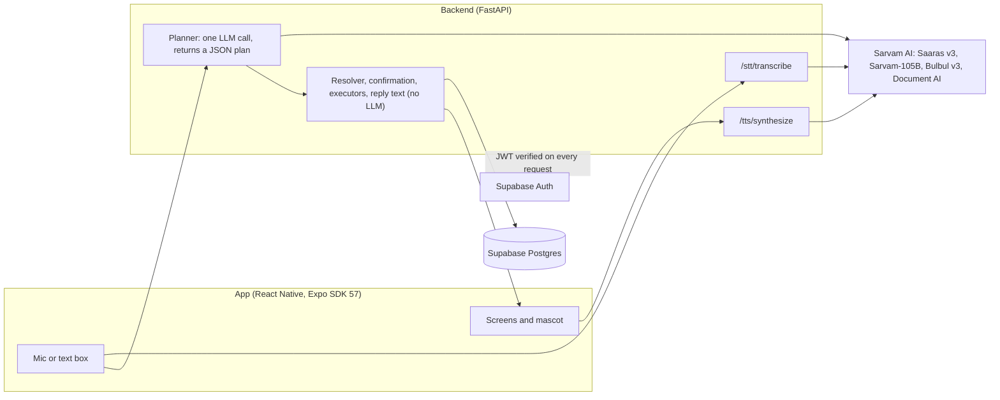

<div align="center">

  

  # Pappu (പപ്പു)
  ### A voice-first money assistant for Malayalam, Manglish and English

  [](https://www.python.org/)
  [](https://fastapi.tiangolo.com/)
  [](https://expo.dev/)
  [](https://supabase.com/)
  [](https://www.sarvam.ai/)
  [](#testing)

  <p align="center">
    <b>Say it the way you would say it to a friend.</b><br/>
    "Innale biriyanikku 250 aayi." Pappu records it, keeps track of who owes whom, and answers back.
  </p>

</div>

---

## What it does

- **Track spending by voice or text.** Add, edit, delete and ask about expenses and income in English, Malayalam or Manglish, often mixed in one sentence.
- **People and debts.** "Rahulinu 500 koduthu" records money given to Rahul. The People tab shows who owes you and whom you owe.
- **Budgets.** Monthly budgets per category, with a warning when you get close or go over.
- **Split a bill.** Photograph a restaurant bill, say who had what, and Pappu works out each share, saves it, and shows a UPI QR to ask a friend to pay.
- **Undo.** The last action, including a whole bill split, can be undone.
- **Pappu the mascot.** A coin character with 10 moods that reacts to listening, thinking, speaking and the state of your money.

Nothing is ever edited or deleted without a confirmation, and a bill split is only saved after you review it.

## How it works

One LLM call decides **what the user means**. Everything after that is ordinary code.



A voice turn, step by step:

1. The app records audio and sends it to `/stt/transcribe` (Sarvam Saaras v3).
2. The transcript goes to `/assistant/message`. The planner sends it to Sarvam-105B with a small context (contacts, recent turns, today's date) and gets back a JSON plan such as `add`, `edit`, `delete`, `query`, `clarify`.
3. Code validates the plan, finds the matching rows, and either runs it or asks: one match to edit or delete means "confirm?", several matches mean "which one?".
4. Code writes the reply text in the user's language. The LLM does not write replies.
5. The app sends the reply to `/tts/synthesize` (Sarvam Bulbul v3) and plays it.

Bill split uses the same idea: Sarvam Document AI reads the photo, one LLM call copies the lines into a structure, a second maps items to people, and the arithmetic is plain code that always adds up to the bill total.

The rules the project holds to:

- The LLM never touches the database. It only returns JSON.
- Edits and deletes always go through confirmation.
- Categories are a fixed list of eight. The LLM cannot invent one.
- Login is Supabase Auth. The backend verifies the JWT and takes the user from it, never from the request body.
- Every query is scoped to the verified user.

Full detail is in [`PROJECT_SPEC.md`](PROJECT_SPEC.md) and progress is in [`BUILD_PHASES.md`](BUILD_PHASES.md).

## Current status

| Area | State |
|:---|:---|
| Text and voice assistant, people, budgets, undo | Built and tested |
| Bill split (Phase 14) | Built and tested, checked end to end in the web app. Camera, voice on the split screen and scanning the QR in a UPI app still need a phone run |
| Voice end to end (Phases 6 to 8) | Built; final acceptance is a manual phone checklist in [`docs/checklists/`](docs/checklists/) |
| Hosted backend on Render | The service at `pappu-78n5.onrender.com` was not responding when last checked (15 Nov 2026). Run the backend locally for now |
| Android build | An earlier APK exists on EAS; it predates bill split. Bill split needs a new build because it adds the camera picker |

## Tech stack

| Layer | What |
|:---|:---|
| App | React Native, Expo SDK 57, React Navigation, React Query, Reanimated, react-native-svg |
| Backend | Python 3.12, FastAPI, SQLAlchemy 2.0, Pydantic v2, httpx |
| Data and login | Supabase Postgres and Supabase Auth (ES256 JWTs verified through JWKS) |
| AI | Sarvam AI: Saaras v3 (speech to text), Sarvam-105B (planner), Bulbul v3 (text to speech), Document AI (bill photos) |
| Hosting | Render (`render.yaml`), Expo EAS for builds |

## Getting started

You need Python 3.12, Node.js 20 or newer, a Supabase project and a Sarvam AI key.

### 1. Clone

```bash
git clone https://github.com/Sangeeth62880/pappu.git
cd pappu
```

### 2. Backend

```bash
cd backend
python3.12 -m venv .venv
source .venv/bin/activate
pip install -r requirements.txt
cp .env.example .env
```

Fill in `backend/.env`: `DATABASE_URL`, `SUPABASE_URL` (or `SUPABASE_JWKS_URL`) and `SARVAM_API_KEY`. The backend refuses to start without the Supabase setting.

Create the tables once (this also applies later schema changes):

```bash
python apply_schema.py
```

Run it:

```bash
uvicorn app.main:app --host 0.0.0.0 --port 8000 --reload
```

### 3. App

```bash
cd frontend
npm install
cp .env.example .env
```

Fill in `frontend/.env`: `EXPO_PUBLIC_API_URL` (for example `http://localhost:8000`), `EXPO_PUBLIC_SUPABASE_URL` and `EXPO_PUBLIC_SUPABASE_ANON_KEY`.

```bash
npx expo start
```

Press `w` for the web version, or scan the QR code with a development build on a phone. Voice recording and the camera need a phone; the web version is fine for everything typed.

Deployment notes are in [`DEPLOY.md`](DEPLOY.md).

## Testing

```bash
cd backend && pytest
```

```bash
cd frontend && npm test
```

821 backend tests and 542 frontend tests pass as of 15 Nov 2026. The backend tests mock Sarvam, so they need no API key. There is also a live evaluation set for the planner in `backend/tests/eval/` that does call Sarvam.

## Safety and limits

- Per-user rate limits on the routes that cost money per call (assistant, speech, bill reading); over the limit returns `429`.
- Size limits on messages, voice uploads (10 MB) and bill photos (8 MB). Bill photos are read and discarded, never stored.
- Error responses never include internal or upstream error text.
- `.env` files are ignored by git. An early commit did contain a test account password; that password has since been changed.

## Repository layout

```
pappu/
├── backend/
│   ├── app/
│   │   ├── assistant/     # v2 planner, resolver, pending confirmations, executors, replies
│   │   ├── routers/       # assistant, bills, budgets, chat, contacts, profile, stt, tts, summary, transactions
│   │   ├── services/      # bill split maths and flow, budgets, balances, undo, tracing
│   │   ├── llm/           # Sarvam LLM client and versioned prompt files
│   │   ├── stt/ tts/ ocr/ # Sarvam speech and Document AI clients
│   │   ├── models/        # SQLAlchemy models
│   │   └── main.py
│   ├── tests/             # pytest suite and the planner eval set
│   ├── apply_schema.py    # creates and updates the database schema
│   └── requirements.txt
├── frontend/
│   ├── src/
│   │   ├── screens/       # Home, Me, Auth, PersonDetail, BillSplit
│   │   ├── components/    # dashboard, history, people, conversation, voice overlay, bill split, ui primitives
│   │   ├── api/           # backend client
│   │   ├── i18n/          # English and Malayalam strings
│   │   └── theme/         # design tokens
│   └── tests/             # Jest and React Native Testing Library
├── supabase/migrations/   # SQL migrations
├── design/                # approved screen designs
├── docs/                  # reports and manual test checklists
├── assets/                # app icons and the 10 mascot poses
├── PROJECT_SPEC.md        # the spec
├── BUILD_PHASES.md        # phases and their status
└── render.yaml
```

---

<div align="center">
  <sub>Malayalam and English, powered by Sarvam AI and Supabase</sub>
</div>
