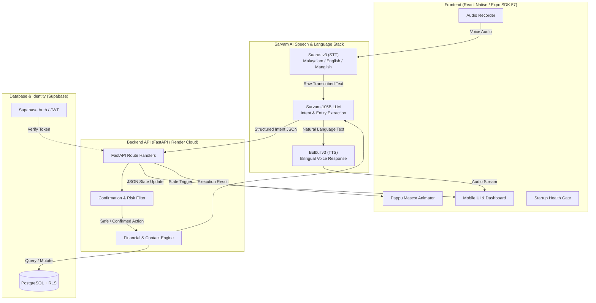
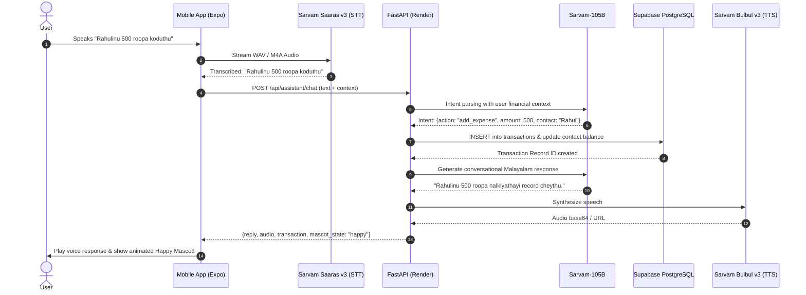

<div align="center">

  

  # Pappu (പപ്പു)
  ### The Bilingual (Malayalam ⇄ English) Voice-First Financial Assistant

  [](https://pappu-78n5.onrender.com/health)
  [](https://expo.dev/accounts/sangeeth122/projects/pappu/builds/c1078d20-4c3c-49ed-9ad6-69e14d6acfe4)
  [](https://www.python.org/)
  [](https://fastapi.tiangolo.com/)
  [](https://expo.dev/)
  [](https://supabase.com/)
  [](https://www.sarvam.ai/)
  [](tests)

  <p align="center">
    <b>Speak naturally in Malayalam, Manglish, or English.</b><br/>
    Pappu tracks expenses, manages debts, schedules reminders, and reports real-time insights with high-fidelity voice and emotional mascot feedback.
  </p>

  [**Explore Features**](#-key-features) •
  [**System Architecture**](#-system-architecture) •
  [**Mascot System**](#-mascot-character-states) •
  [**Live Deployment**](#-live-deployment--downloads) •
  [**Getting Started**](#-getting-started)

</div>

---

## 🌟 Highlights

- 🗣️ **Voice-First & Code-Mixed Understanding**: Fluent understanding of Malayalam, Manglish (*"Innale biriyanikku 250 roopa aayi"*), and English voice inputs.
- 🪙 **Animated Mascot (Pappu)**: 10 expressive vector SVG states that react in real-time to user speech, financial balance, and assistant processing.
- 🧠 **Sarvam AI Intelligence Stack**:
  - **Saaras v3** for speech-to-text with Indian accent & code-mixed Malayalam fluency.
  - **Sarvam-105B** for conversational context, multi-turn dialogue, and structured intent classification.
  - **Bulbul v3** for low-latency natural text-to-speech audio feedback.
- 🛡️ **Risk-Gated Action Planner**: High-risk financial operations (bulk deletion, large transfers) prompt interactive confirmations before touching the database.
- 📱 **Cross-Platform**: Production-ready Android standalone APK (EAS internal distribution) and iOS compatible via Expo Go / Xcode personal development.

---

## 🏗️ System Architecture

Pappu operates on an audited six-layer decoupled pipeline:



### End-to-End Processing Flow



---

## 🎨 Mascot Character States

Pappu is represented by a coin mascot with dynamic real-time poses extracted from the design system:

| State | Preview Pose | Description & Trigger |
|:---|:---:|:---|
| **Idle** | [`pappu-idle.svg`](assets/pappu/svg/pappu-idle.svg) | Default calm state on dashboard ready for interactions. |
| **Listening** | [`pappu-listening.svg`](assets/pappu/svg/pappu-listening.svg) | Active microphone recording, soundwave glyphs, cupped ear. |
| **Thinking** | [`pappu-thinking.svg`](assets/pappu/svg/pappu-thinking.svg) | Processing speech transcript and calculating AI intent. |
| **Speaking** | [`pappu-speaking.svg`](assets/pappu/svg/pappu-speaking.svg) | Playing Sarvam Bulbul TTS voice response. |
| **Happy** | [`pappu-happy.svg`](assets/pappu/svg/pappu-happy.svg) | Successful savings, debt settlement, or low expenses. |
| **Excited** | [`pappu-excited.svg`](assets/pappu/svg/pappu-excited.svg) | Milestone achieved, salary credited, or debt fully paid. |
| **Concerned** | [`pappu-concerned.svg`](assets/pappu/svg/pappu-concerned.svg) | Budget threshold exceeded or pending high borrow amounts. |
| **Worried** | [`pappu-worried.svg`](assets/pappu/svg/pappu-worried.svg) | Negative balance warning or critical expense overspend. |
| **Confused** | [`pappu-confused.svg`](assets/pappu/svg/pappu-confused.svg) | Ambiguous speech input prompting clarification. |
| **Sleepy** | [`pappu-sleepy.svg`](assets/pappu/svg/pappu-sleepy.svg) | Inactivity mode and calm nighttime backdrop. |

---

## 🚀 Live Deployment & Downloads

| Service | Environment | Status | Endpoint / Link |
|:---|:---|:---:|:---|
| **Backend API** | Render (Standard Web Service) | [](https://pappu-78n5.onrender.com/health) | [`https://pappu-78n5.onrender.com`](https://pappu-78n5.onrender.com) |
| **Health Check** | Render Cloud | `200 OK` | [`/health`](https://pappu-78n5.onrender.com/health) |
| **Database** | Supabase Managed PostgreSQL | `connected` | Supabase Cloud (`mvobtveaewxgiczulyrq`) |
| **Android APK** | Standalone Android Build | [](https://expo.dev/accounts/sangeeth122/projects/pappu/builds/c1078d20-4c3c-49ed-9ad6-69e14d6acfe4) | [Download Latest APK (EAS)](https://expo.dev/accounts/sangeeth122/projects/pappu/builds/c1078d20-4c3c-49ed-9ad6-69e14d6acfe4) |
| **iOS Testing** | Expo Go / Sideload | `active` | Project slug: `pappu` (SDK 57) |

---

## 💻 Tech Stack Matrix

```
┌────────────────────────────────────────────────────────────────────────┐
│                              FRONTEND                                  │
├─────────────────┬─────────────────┬──────────────────┬─────────────────┤
│ React Native    │ Expo SDK 57     │ Tailwind CSS     │ React Navigation│
│ NativeWind v4   │ Reanimated 4    │ React Query v5   │ SVG Vectors     │
├─────────────────┴─────────────────┴──────────────────┴─────────────────┤
│                              BACKEND                                   │
├─────────────────┬─────────────────┬──────────────────┬─────────────────┤
│ Python 3.12.0   │ FastAPI         │ SQLAlchemy ORM   │ Pydantic v2     │
│ Uvicorn ASGI    │ psycopg2-binary │ Pytest (312 T.)  │ Docker Slim     │
├─────────────────┴─────────────────┴──────────────────┴─────────────────┤
│                            CLOUD & AI                                  │
├─────────────────┬─────────────────┬──────────────────┬─────────────────┤
│ Supabase Auth   │ PostgreSQL RLS  │ Sarvam Saaras v3 │ Sarvam 105B LLM │
│ Sarvam Bulbul v3│ Render Hosting  │ Expo EAS Cloud   │ Tailscale Dev   │
└─────────────────┴─────────────────┴──────────────────┴─────────────────┘
```

---

## 🛠️ Getting Started

### Prerequisites

- **Python 3.12.x** (Strictly pinned for backend stability)
- **Node.js 20+** and `npm`
- **Expo CLI** (`npm install -g eas-cli`)
- Free or Pro account on **Supabase** and **Sarvam AI**

### 1. Clone the Repository

```bash
git clone https://github.com/Sangeeth62880/pappu.git
cd pappu
git checkout ui-stitch-v3
```

### 2. Backend Setup

```bash
cd backend

# Create virtual environment with Python 3.12
python3.12 -m venv .venv
source .venv/bin/activate

# Install pinned dependencies
pip install -r requirements.txt

# Configure environment
cp .env.example .env
# Edit .env with your Supabase DB URL and Sarvam API keys

# Run unit tests
pytest

# Start local server
uvicorn app.main:app --host 0.0.0.0 --port 8000 --reload
```

### 3. Frontend Setup

```bash
cd ../frontend

# Install dependencies
npm install

# Configure environment
cp .env.example .env
# Set EXPO_PUBLIC_API_URL=https://pappu-78n5.onrender.com (or local IP)
# Set your EXPO_PUBLIC_SUPABASE_URL and EXPO_PUBLIC_SUPABASE_ANON_KEY

# Run unit and component test suite
npm test

# Launch Expo Dev Server
npx expo start -c
```

### 4. Running on Physical Devices

- **Android**:
  Download and install the standalone `.apk` directly onto your phone from the [EAS Build Page](https://expo.dev/accounts/sangeeth122/projects/pappu/builds/c1078d20-4c3c-49ed-9ad6-69e14d6acfe4).
- **iPhone (iOS)**:
  1. Install **Expo Go** from the Apple App Store.
  2. Run `npx expo start -c` on your Mac.
  3. Scan the terminal QR code with your iPhone Camera to open Pappu instantly.

---

## 🧪 Testing & Verification

Comprehensive test suites protect against regressions across backend business logic and frontend UI components:

```bash
# Backend Test Suite (312 tests passing)
cd backend && pytest -v

# Frontend Test Suite (230 tests across 27 suites passing)
cd frontend && npm test
```

- **Health Verification**: Startup health gate verifies database connectivity and provides automatic cold-start recovery screens without crashing.
- **Safety Audit**: Zero credentials or service keys committed in Git history (`.gitignore` enforced for all `.env*` files).

---

## 📁 Repository Structure

```
pappu/
├── assets/
│   ├── brand/               # App icons, splash screens, foregrounds
│   └── pappu/               # 10 Mascot poses (SVG & PNG catalog)
├── backend/
│   ├── app/
│   │   ├── api/             # REST Routers (auth, assistant, transactions, contacts)
│   │   ├── core/            # Config, security, logging
│   │   ├── models/          # SQLAlchemy ORM schemas
│   │   ├── services/        # AI orchestration, Sarvam client, planners
│   │   └── main.py          # FastAPI application factory & health probe
│   ├── tests/               # 312 Pytest test cases & evaluation harnesses
│   ├── .python-version      # Pinned Python version (3.12.0)
│   ├── Dockerfile           # Production container specification
│   └── requirements.txt     # Pinned production Python dependencies
├── frontend/
│   ├── src/
│   │   ├── api/             # HTTP & WebSocket API client
│   │   ├── components/      # UI components, Mascot, StartupHealthGate
│   │   ├── navigation/      # TabBar, Stack Navigators
│   │   └── screens/         # Home, Chat, History, People, Settings
│   ├── eas.json             # EAS Build Profiles (Android APK & iOS)
│   ├── app.json             # Expo application configuration & plugins
│   └── tests/               # 230 Jest test cases
├── supabase/
│   └── migrations/          # PostgreSQL schema, RLS, audit logs
└── render.yaml              # Render Cloud Infrastructure as Code
```

---

<div align="center">
  <sub>Built with ❤️ for bilingual speakers • Malayalam & English • Powered by Sarvam AI & Supabase</sub>
</div>
